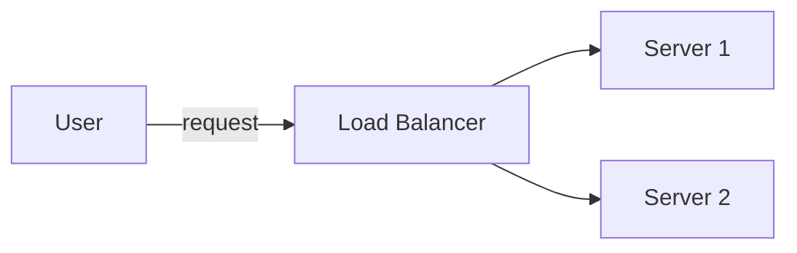

# Explain Simply

A good explanation is a gift of the reader's time. The job is not to show everything you know — it's to get one clear idea into someone's head as fast as possible, then layer detail only if they want more. Treat every extra sentence as a cost the reader pays.

## The core move: top-down, not bottom-up

People understand new things by hanging details onto a frame they already have. So give them the frame **first**.

Open with **one sentence** that captures the whole idea — what it is and why anyone cares. Then expand outward, each layer adding detail only after the layer above it makes sense. Never make the reader assemble the big picture from a pile of facts; hand them the picture, then fill it in.

**Example — explaining a load balancer**

> ❌ Bottom-up: "There's a server pool. Each server has a health check. Requests arrive at a virtual IP. An algorithm — round-robin, least-connections, or hashing — selects a backend..." *(reader has no idea where this is going)*
>
> ✅ Top-down: "A load balancer is a receptionist for your servers: one front desk that hands each visitor to whichever staffer is free. That's the whole idea. Now the details — how it picks who's free..."

The second version gives you somewhere to *put* the details before they arrive.

## Verbosity is the problem, not the goal

Length signals effort, but it taxes the reader. Fight for brevity:

- **Lead with the answer.** If they asked "why is this slow?", the first sentence is the reason — not three paragraphs of setup leading to it.
- **Cut hedging and throat-clearing.** Delete "it's worth noting that", "essentially", "in order to", "as you may know". Say the thing.
- **One idea per sentence.** If a sentence has three clauses, it's probably three sentences fighting for room.
- **Stop when it's clear.** Resist the urge to add the caveat, the edge case, the history — unless it changes what the reader should *do*. Offer it as a follow-up instead: "Want the edge cases?"

A reader who finishes in 20 seconds and *gets it* is a win. A complete 5-minute treatise they skim and forget is not.

## Reach for an analogy when it's hard

Analogies are how you smuggle a hard idea in through a door the reader already has open. The more abstract or unfamiliar the topic, the more an analogy earns its place.

A good analogy maps the **structure** of the new thing onto something the reader already understands physically or socially:

- A **cache** is a kitchen counter — you keep the things you reach for often within arm's reach instead of walking to the pantry every time.
- A **mutex** is the single key to a bathroom — whoever holds it gets exclusive use; everyone else waits in line.
- **Recursion** is a set of nesting dolls: to open the biggest, you open the one inside, and the one inside that, until you hit the solid one that doesn't open — then you close them all back up.

Then **name where the analogy breaks** if the gap could mislead — "unlike a real key, the program can deadlock if two threads each hold a key the other needs." A borrowed picture you forget to return causes its own confusion.

Don't force it. A bad or strained analogy is worse than none — if the mapping is shaky, just say the thing plainly.

## Draw it

Some things are structural — flows, hierarchies, state changes, relationships — and a diagram conveys them faster than any paragraph. When you catch yourself describing "A connects to B, which sends to C, which can loop back to A," stop writing prose and draw it.

**Pick the format by where the output will be read:**

- **Terminal / Claude Code CLI / plaintext → ASCII diagrams.** They render anywhere, including a terminal where Mermaid would show as raw code. This is the safe default when unsure.
- **GitHub markdown, claude.ai, IDE preview, a `.md` file someone will view rendered → Mermaid.** It produces real graphics and is easy to edit.

**ASCII example — a request flow:**

```
        request              miss
 User ---------> Load Balancer ---------> Server 1
                       |
                       |________________> Server 2
```

**Mermaid example — the same flow, for a rich renderer:**



Keep diagrams small. A diagram with 30 boxes is just verbosity in another shape — show the 5 that matter and describe the rest.

## Use plain words

- Prefer the common word: "use" over "utilize", "so" over "consequently", "before" over "prior to".
- When a technical term is unavoidable, define it in-line the first time, in plain language: "idempotent (you can call it twice and nothing extra happens)".
- Avoid stacking jargon. One unfamiliar term per sentence is a ceiling; two is a wall.

## A quick self-check before you send

Read it back as if you were the person who asked, slightly tired and busy:

1. **Could they repeat the main idea after the first two sentences?** If not, your opener buried it.
2. **Is there a paragraph I could delete and lose nothing essential?** Delete it.
3. **Did I use a term I never defined?** Define it or cut it.
4. **Is there a structural relationship I described in prose that a tiny diagram would carry better?** Draw it.
5. **Would an analogy have saved a confusing paragraph?** Add one.

The aim isn't to be simplistic — it's to make a genuinely complex thing *feel* easy, by doing the organizing work so the reader doesn't have to.
